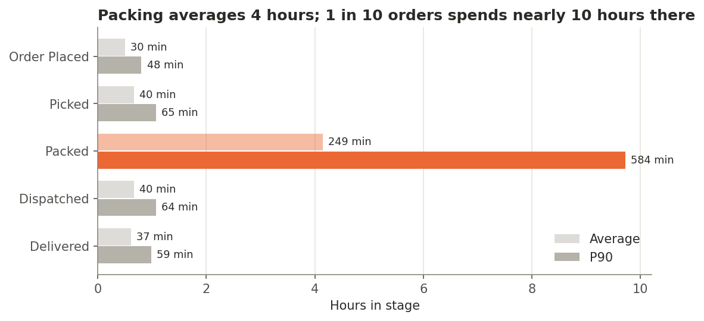
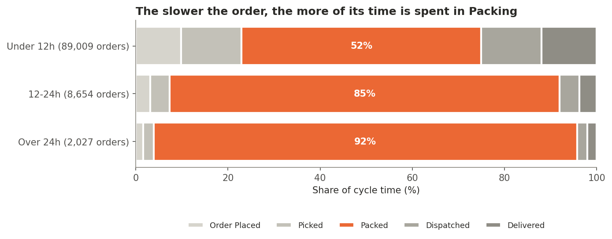
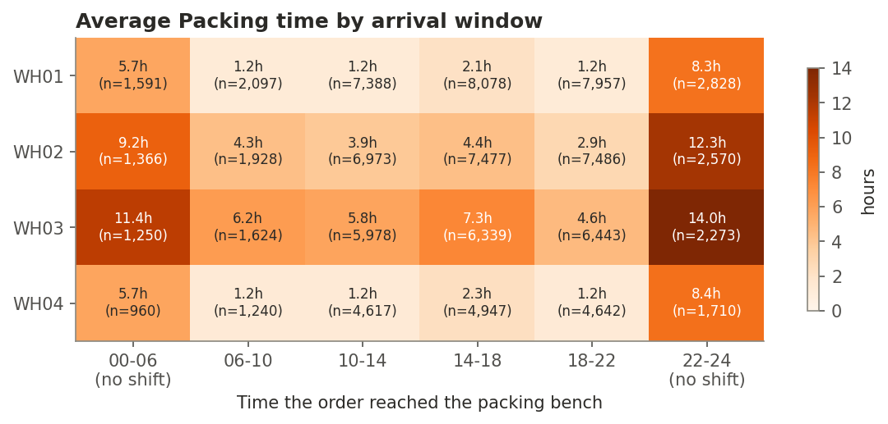
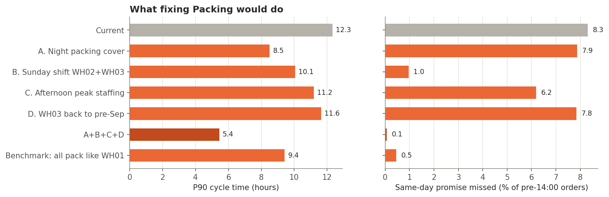

# Order-to-Delivery Process Bottleneck Analysis

Which stage of the order-to-delivery process takes the longest, and where would fixing it cut total cycle time the most?

I made an event log of 100,000 orders going through five stages (Order Placed, Picked, Packed, Dispatched, Delivered) at four warehouses over 90 days. Then I analysed it with SQL and Python: time per stage, average vs P90/P95, which stage the slow orders get stuck in, and that stage broken down by warehouse, region, time of day, day of week and week.

Tools: SQL (SQLite), Python (pandas, matplotlib, scipy), Jupyter.

## Findings

- Packing is the bottleneck. It's 63% of all process time, 4.2 hours on average. Every other stage takes 30-40 minutes.
- The average hides how bad it is. Packing's P90 is 9.7 hours, 2.3x its average. For the other stages the P90 is about 1.6x the average.
- Orders that took more than 24 hours spent 92% of that time in Packing. Orders that took 12-24 hours spent 85%.
- Most of the delay comes from a few places. WH02 and WH03 don't pack on Sundays, so Sunday orders wait about 17 hours. Nothing is packed between 22:00 and 06:00. 14:00-18:00 is the slowest part of the day. WH03 got slower from mid-September.
- Delivery region makes no difference once you account for which warehouse the order came from.







## Recommendation

Start with a Sunday packing shift at WH02 and WH03. That alone takes same-day delivery misses from 8.3% to 1.0% and cuts orders over 12 hours by almost two thirds. After that: test extra cover for the overnight gap, add packing staff for 14:00-18:00, and find out what changed at WH03 in mid-September.

With all four changes, average Packing time goes from 4.2 to 1.5 hours and P90 cycle time from 12.3 to 5.4 hours.



Full write-up: [reports/recommendation.md](reports/recommendation.md)

## Data

`data/process_events.csv.gz` is created by `src/generate_data.py` with a fixed seed, so it comes out the same every time. It's gzipped (5 MB instead of 35 MB) and pandas reads it as is. One row per order per stage:

| Column | Description |
|---|---|
| OrderID | ORD-10001 to ORD-110000 |
| Stage | Order Placed, Picked, Packed, Dispatched, Delivered |
| StageStartTime | when the order entered the stage |
| StageEndTime | when it left (empty if it was still in that stage when the data was pulled) |
| WarehouseID | WH01-WH04 |
| Region | delivery region: North, West, South, East |

The data is simulated. I set it up with a few problems a real warehouse might have (shift hours, no Sunday shift at two sites, one understaffed site, a busy afternoon) and 310 orders that were still in progress at the cut-off. The analysis only uses the log itself to find them. The numbers are made up, but the same steps would work on a real WMS or OMS export.

## SQL

Everything runs on SQLite. `sql/00_views.sql` creates three views: `stage_durations` (time per order per stage), `complete_orders`, and `order_cycle` (one row per delivered order with minutes per stage and total hours).

| File | What it shows |
|---|---|
| 01_data_checks.sql | row counts, in-progress orders, negative durations, duplicates, gaps between stages |
| 02_stage_durations.sql | time in each stage per order (exports a 20-order sample) |
| 03_stage_summary.sql | average, median, P90, P95 and share of total time per stage |
| 04_order_cycle_time.sql | end-to-end cycle time percentiles |
| 05_slow_order_breakdown.sql | share of time per stage for orders under 12h, 12-24h and over 24h |
| 06_packing_by_warehouse.sql | packing average and P90 by warehouse |
| 07_stage_by_warehouse_region.sql | every stage by warehouse and region |
| 08_packing_by_arrival_time.sql | packing time by the hour the order reached packing |
| 09_packing_by_weekday.sql | packing time by day of week |
| 10_weekly_trend.sql | weekly averages per stage over the 90 days |

SQLite doesn't have a percentile function, so I calculate P90 and P95 with `ROW_NUMBER()` and `COUNT()` (nearest-rank method). The notebook uses the same method and checks its results against the SQL output.

## Handling 1 lakh orders

I started with 500 orders and moved to 100,000 so that each warehouse and time-of-day combination has thousands of orders, not a handful. A few things I did for the bigger size:

- The data file is gzipped, and the generator writes exactly the same file each run.
- `src/run_sql.py` loads the data into SQLite in chunks of 100k rows, adds indexes on `(OrderID, Stage)` and `Stage`, and prints how long each query takes. All the SQL runs in about 15 seconds.
- The query outputs are summaries. The one per-order query only exports a sample, so `outputs/` stays small.
- The packing chart plots 1,500 sample orders per warehouse so it stays readable. The median and P90 lines still use all orders.
- With this many orders almost every difference is statistically significant, so I looked at how big the differences are rather than just the p-values.

Generating the data, running the SQL and running the notebook takes under a minute in total.

## Notebook

[notebooks/process_bottleneck_analysis.ipynb](notebooks/process_bottleneck_analysis.ipynb) has the data checks, stage percentiles, box plots, the slow-order breakdown, warehouse and region comparison (Kruskal-Wallis and Mann-Whitney tests), time of day and day of week, the 90-day trend and the what-if scenarios. It's built from `src/analysis.py`.

## How to run

```
pip install -r requirements.txt
python run_all.py
```

This creates the data, runs the SQL into `outputs/` and runs the notebook. Charts are saved to `reports/figures/`.

## Project structure

```
data/            process_events.csv.gz
sql/             00_views.sql + 10 analysis queries
src/             generate_data.py, run_sql.py, analysis.py, make_notebook.py
outputs/         one CSV per SQL query
notebooks/       analysis notebook
reports/         recommendation.md, figures/
```
